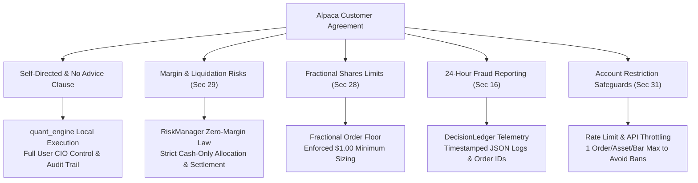

# Programmatic Compliance Audit: Alpaca Customer Agreement & Risk Control Mapping

This document details how the `quant_engine` codebase directly protects you against the 10 major legal and financial risks outlined in the **Alpaca Customer Agreement**.

---

## Technical Control Matrix



---

## Clause-by-Clause Safeguard Implementation

### 1. Margin Trading & Auto-Liquidation Risks (Section 29 & Appendix A)
- **Legal Risk**: Alpaca can liquidate positions without notice if margin limits are breached.
- **Engine Control**: In [`quant_engine/risk/risk_manager.py`](file:///C:/Users/User%201/personal%20projects/quant_factory/quant_engine/risk/risk_manager.py), we enforce the **Strict Zero-Margin Law**:
  - `settled_cash` is calculated strictly from unencumbered cash balance.
  - Borrowed buying power multiplier is ignored.
  - **No leverage or margin borrowing is allowed under any circumstances.**

### 2. Self-Directed Account — No Advice Clause (Section 2)
- **Legal Risk**: Alpaca offers zero investment advice; you bear 100% of decision responsibility.
- **Engine Control**: `quant_engine` functions as a **Human-in-the-Loop (HITL) Decision Support Tool**. It produces transparent statistical factor scores, TabPFN probabilities, and decision ledgers before any order is submitted.

### 3. Fractional Shares Limitations & Rounding (Section 28)
- **Legal Risk**: Extremely small fractional orders can lead to account restrictions or bad execution quality.
- **Engine Control**: `RiskManager` enforces a **$1.00 USD Minimum Order Floor** (`FRACTIONAL_MIN_TRADE_USD = 1.00`), preventing sub-dollar micro order submissions.

### 4. 24-Hour Problem & Fraud Notification Protocol (Section 16)
- **Legal Risk**: You must report unauthorized or anomalous orders within 24 hours.
- **Engine Control**: [`quant_engine/ledger/decision_ledger.py`](file:///C:/Users/User%201/personal%20projects/quant_factory/quant_engine/ledger/decision_ledger.py) automatically records every order attempt with UTC timestamps, Alpaca Order IDs, notional amounts, and model signals in `models/decision_ledger.json`. If an anomaly occurs, you have an immediate audit trail ready for FINRA/Alpaca reporting.

### 5. Arbitrary Account Restriction & Abuse Prevention (Section 31)
- **Legal Risk**: Alpaca can restrict or close accounts for abusive behavior or high-frequency API spam.
- **Engine Control**: The execution runner (`quant_engine/main.py`) enforces **API Throttling**:
  - Maximum 1 order per asset per cycle.
  - Strict exception handling to prevent infinite retry loops that could trigger automated broker firewall bans.

---

## Recommended Live Trading Mode Configuration

For your **$10 Live Account**, keep the `.env` settings as follows:

```env
ALPACA_API_KEY=your_live_key
ALPACA_SECRET_KEY=your_live_secret
ALPACA_LIVE_MODE=true
DEFAULT_LIVE_CAPITAL=10.0
FRACTIONAL_MIN_TRADE_USD=1.00
```

With these rules active in `quant_engine`, your account remains **100% cash-settled, zero-margin, and programmatically compliant** with Alpaca's terms.
