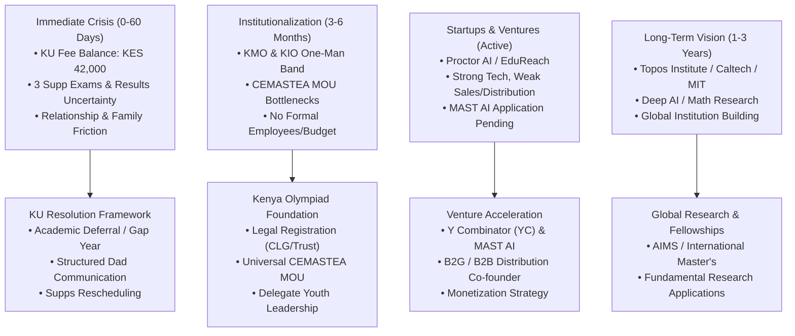

# Strategic Life Roadmap & Action Plan: Dalton Omondi Opondo

> [!NOTE]
> Prepared for **Dalton Omondi Opondo** | August 2026 Strategy Document
> **Location Context**: AIMS (African Institute for Mathematical Sciences), Kigali, Rwanda (Through October 2026)

---

## Executive Summary & Mental Reset

You are experiencing a convergence of high ambition, extreme conscientiousness, and severe immediate constraints (financial, academic, and institutional). 

This is a classic **"Pivot & System Design"** phase. Up until now, you have been acting as a **single-point-of-failure hero**—personally coaching, coding, organizing, handling logistics, and absorbing institutional stress. When single-point systems face resource shocks (fee balances, failed exam supps, family friction), the entire system collapses into burnout.

Your path forward is not "working harder at the same things." It is **restructuring your life into scalable modules**, taking advantage of your current window at AIMS Kigali, and decoupling your identity and future from the immediate dysfunction of local university bureaucracy.

---

## Diagnostic Breakdown of Current Challenges



---

## Actionable Strategy by Pillar

### Pillar 1: Kenyatta University (KU) & Academic Crisis Management

#### 1. Realizing the Nature of the Problem
- **The Fee Balance (KES 42,000)** and **3 Failed Exams** are administrative problems, not character flaws.
- Engineering degrees in Kenyan public universities are notorious for rigid administrative penalties, but they offer options like **Academic Deferral / Formal Gap Year**.

#### 2. Communicating with your Father (Scripting & Framing)
- **Do not present it as a confession of failure.** Present it as a strategic operational update with a clear financial path.
- **Framing**:
  > *"Dad, as I complete my international fellowship program here at AIMS in Kigali, I am reviewing my final university phase at Kenyatta University. Due to fee reconciliation delays from the university, there is an outstanding statement balance of KES 42,000 required before I can sit for the pending supplementary modules. I am structuring my project schedules and venture applications so that I can clear this in manageable installments/funding."*

#### 3. Strategic Options Matrix for KU

| Option | Pros | Cons | Recommendation |
| :--- | :--- | :--- | :--- |
| **Option A: Immediate Deferral / Gap Year** | Eliminates immediate fee stress; allows full focus on MAST AI / YC / AIMS Kigali until 2027. | Delays graduation year slightly. | **HIGHLY RECOMMENDED** if MAST AI or funding lands. |
| **Option B: Raise KES 42k + Supp Fees** | Keeps degree timeline strictly on track. | High emotional and financial stress right now. | Pursue only if funding is secured without personal debt. |
| **Option C: Drop Out / Pivot Entirely** | Full freedom for startups/research. | High risk, potential family fallout. | Not recommended unless secured $100k+ seed investment. |

> [!TIP]
> **Key Insight**: If **MAST AI** accepts you, **take a formal 1-year academic deferral from KU immediately**. A deferral protects your enrollment status legally while giving you complete freedom to build your startup with zero university interference.

---

### Pillar 2: The Kenya Olympiad Foundation (KOF)

You cannot remain the sole "youth on the ground." You must transition from **head coach who does everything** to **Chairman / Founder of a formal Foundation**.

```
[ Kenya Olympiad Foundation (KOF) ]  <-- Umbrella Legal Entity (Non-Profit / CLG)
        │
        ├── Kenya Mathematical Olympiad (KMO)
        ├── Kenya Informatics Olympiad (KIO)
        └── Kenya Physics Olympiad (KPO - Future)
        │
        └── Unified CEMASTEA MOU & Corporate Sponsorship Registry
```

#### Step-by-Step Institutionalization (Next 90 Days):

1. **Step 1: Step Down from Low-Leverage Roles** (Already Done)
   - Handing over IEEE Photonics Chair at KU was the right decision. Protect your energy ruthlessly.

2. **Step 2: Legal Entity Registration**
   - Register **Kenya Olympiad Foundation** as a Company Limited by Guarantee (CLG) or Society in Kenya.
   - Assign Dr. Gatende and Mr. Martin as Advisory Board Members, while appointing 2–3 active past olympiad alumni as **Operations Lead** and **Logistics Lead**.

3. **Step 3: The Universal CEMASTEA MOU**
   - Draft an umbrella MOU between **Kenya Olympiad Foundation** and **CEMASTEA**.
   - Instead of separate negotiations for KMO and KIO, the MOU covers all national STEM olympiads hosted under KOF.

4. **Step 4: Institutional Fundraising & Sponsorship Deck**
   - CEMASTEA provides access to schools/camps, but zero funding.
   - Build a standard 5-page sponsorship proposal targeting:
     - Safaricom Foundation / M-PESA Foundation
     - Equity Group Foundation
     - Tech companies operating in East Africa (Google Africa, Microsoft ADC, Gebeya, etc.)
     - International Math Organizations (IMU, ICTP, Clay Math Institute outreach grants)

---

### Pillar 3: Startups, MAST AI, Y Combinator & The Sales Gap

#### 1. Solving the "I can build but can't sell" Problem
- Selling is not magic; it is **distribution alignment**.
- For EdTech / Proctor AI:
  - **B2C (Selling to individual students)**: Extremely hard, high friction, low purchasing power in Africa.
  - **B2G / B2B (Selling to Institutions/Olympiads/Universities)**: High contract value, clear pain point (reducing competition/exam costs).
- **Action**: Partner with an ambitious non-technical co-founder (or business lead) who lives for operations, sales, and pitch decks, OR sell directly to institutional buyers (e.g., national exam boards, contest organizers).

#### 2. Startup Accelerator Strategy

```
                          [ Current State: AIMS Kigali ]
                                      │
            ┌─────────────────────────┴─────────────────────────┐
            ▼                                                   ▼
   [ MAST AI Program ]                                [ Y Combinator (YC) ]
   • Primary focus currently                          • Apply for upcoming cohort
   • Validates AI product                             • Highlight Proctor AI & scale
   • Provides runway/safety net                       • Emphasize technical depth
```

- **Y Combinator (YC)**: Apply immediately for the upcoming YC batch! YC strongly favors technical founders who build high-leverage software (like AI proctoring, scalable evaluation engines) for underserved markets.
- **Other Programs to Target**:
  - **Entrepreneur First (EF)** (helps pair technical founders with business co-founders)
  - **Fast Forward** (for tech non-profits like KOF)
  - **Google for Startups Accelerator Africa**

---

### Pillar 4: Fundamental Research Trajectory (Topos, Caltech, MIT)

You have a deep affinity for mathematical foundations, category theory, and first-principles AI research.

- **Topos Institute**: Outstanding target. Topos focuses on category theory, compositionality, open systems, and ethical AI. 
  - *Action*: Reach out to researchers at Topos whose papers match your interest in number theory, graph theory, or categorical computer science. Apply for their summer research internships or independent research fellow roles.
- **Caltech / MIT / Ivy League**:
  - Do not mourn missing undergraduate abroad. Graduate school (PhD / Master's) at MIT, Caltech, or Stanford is far more funded, prestigious, and intellectually freeing.
  - Your path to MIT/Caltech is through **demonstrated original output**: AIMS research papers, KMO/KIO national impact, Kaggle top finishes, and novel AI architectures.

---

## Weekly Time Allocation Framework (AIMS Kigali Phase: Aug–Oct 2026)

To prevent overwhelm, divide your available 50 hours of deep work per week into exact percentages:

| Focus Area | Weekly Hours | Primary Deliverables |
| :--- | :--- | :--- |
| **Startups & Applications** | **20 hrs (40%)** | MAST AI prep, YC Application, Proctor AI distribution strategy. |
| **KOF Institutional Structure**| **15 hrs (30%)** | Draft KOF constitution, universal CEMASTEA MOU draft, recruit 2 alumni leads. |
| **Research & Graduate Prep** | **10 hrs (20%)** | Self-study (Category Theory/vLLM), Topos Institute outreach, GRE/paper reading. |
| **KU Crisis Resolution** | **5 hrs (10%)** | Structured communication with father, formal deferral application or supp schedule. |

---

## Mental Model for the "Manic & Conscientious" Mind

> *"The standard does not care. That is why it works."*

You live by this principle. But remember:
1. **The standard applies to systems, not to self-punishment.** A broken system (KU's fee delays, un-funded olympiad logistics) cannot be fixed by sacrificing your mental health.
2. **Resource scarcity is temporary; leverage is permanent.** The code you write, the foundation you register, and the networks you build in Kigali at AIMS will outlast any temporary fee balance.
3. **You are currently in Kigali at AIMS.** Use this environment. Talk to the professors, researchers, and fellow mathematical minds at AIMS every single day. They are your tribe.

---

## Immediate Next Steps (Checklist)

- [ ] **Draft the KU Communication**: Send the factual, strategic update to your father.
- [ ] **Submit Y Combinator Application**: Use your Proctor AI and Olympiad platform metrics.
- [ ] **Draft Kenya Olympiad Foundation (KOF) Proposal**: Outline the board, CEMASTEA universal MOU, and delegation model.
- [ ] **Reach out to Topos Institute / Research Mentors**: Draft a concise cold email sharing your work in math olympiads and interest in categorical/compositional AI.
