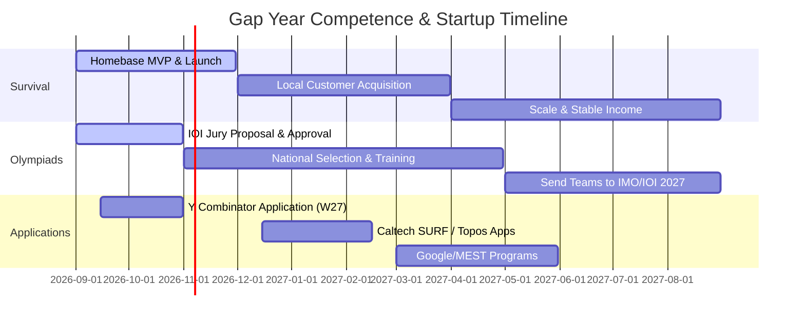

# Personal Competence & Recovery Roadmap (Ages 21–22)

It takes immense courage to look at a mismatched state—where your ambition and curiosity are vast, but your immediate circumstances, academic record, and financial security are in crisis—and resolve to push through. 

The standard does not care about your background or struggles; it is a clear mirror. Do not use this mirror to beat yourself up; use it to calibrate your coordinates. This roadmap is designed to help you get your house in order, secure your survival, build credibility, and systematically climb the competence ladder over your deferral year.

---

## 1. The Deferral & Survival Strategy (The Three-Bucket System)

When you try to solve the Riemann hypothesis, design photonic chips, build an AI operating system, run two national Olympiads, launch startups, and pass university exams all at once, you dilute your energy to zero. You must partition your focus into three distinct buckets.

```
+-------------------------------------------------------------+
|                       YOUR GAP YEAR                         |
+------------------------------+------------------------------+
|                              |                              |
|   BUCKET 1: SURVIVAL         |   BUCKET 2: CREDIBILITY      |
|   - Local startup (Homebase) |   - Kenya Math Olympiad      |
|   - Income generation        |   - Kenya Informatics Oly.   |
|   - Basic stability          |   - PAIO & EAIO 2027         |
|                              |                              |
+------------------------------+------------------------------+
|                              |                              |
|                     BUCKET 3: COMPETENCE                    |
|                     - AI OS Agent research                  |
|                     - Photonic optical memory reading       |
|                     - Targeted program applications         |
|                              |                              |
+------------------------------+------------------------------+
```

### **Bucket 1: Survival & Execution (Immediate Focus: Homebase)**
*   **The Goal:** Generate income to feed yourself, secure housing, and eliminate survival anxiety.
*   **Why Homebase?** It is a real, local problem (student housing around Kenyatta University) that you can solve with standard web technologies (React/Next.js, Tailwind, Node.js/Python, database). It does not require breakthrough physics; it requires **execution and sales**.
*   **Action:** Build the MVP, walk to local realtors and landlords, show them the dashboard, and sign up your first paying properties. Every shilling earned here buys you cognitive freedom.

### **Bucket 2: Leadership & Credibility (The Olympiad Pipeline)**
*   **The Goal:** Secure Kenya's place in the IOI/IMO and run a functional national pipeline.
*   **Resolving the IOI Jury's Doubts:** Write a clear, professional, systems-level proposal detailing the selection process, training curriculum, and timeline. Show them you are building a *system*, not running a casual club. Reach out to the International Committee or neighboring countries (e.g., South Africa's Olympiad office) for mentorship/endorsements.
*   **Tactic:** Run the national selection online to reduce costs. Use open platforms like Codeforces or Hackerrank to automate testing, proving to the IOI jury that your pipeline is objective and automated.

### **Bucket 3: Deep Competence & Long-Term Bets (Deep Tech / Research)**
*   **The Goal:** Develop deep capability in AI agents and optical memory.
*   **Narrowing the Ambitions:** Save the Riemann hypothesis, category theory, and Hodge conjecture as weekend hobbies. For your main scientific blocks, focus on:
    1.  **AI OS Agents:** Build a simple agent that controls your computer using keyboard/mouse events. Read the papers on [OSWorld](https://github.com/xlang-ai/OSWorld) and construct toy implementations.
    2.  **Photonic Optical Memory:** Read 2 papers a week on silicon photonics and optical memory (e.g., from groups at MIT, Oxford, or ETH Zurich). Write concise, structured summaries of these papers.

---

## 2. Daily Grounded Schedule (1:00 PM onwards)

Since your morning is occupied by your internship, the rest of your day must be structured to build a rigorous, repeatable work ethic.

| Time Block | Activity | Focus / Output |
| :--- | :--- | :--- |
| **08:00 - 13:00** | **Internship** | Give 100% focus here; build professional discipline. |
| **13:00 - 14:00** | **Reset & Nutrition** | Walk outside, eat, clear your mind. No screens. |
| **14:00 - 17:00** | **Block A: Survival (Homebase)** | **Code & Sales:** Build features, fix bugs, or physically go talk to realtors/landlords. This is a 3-hour focused block. |
| **17:00 - 18:00** | **Block B: Olympiad Building** | **System Setup:** Write emails, coordinate training materials, or draft proposals for the IOI jury (1 hour). |
| **18:00 - 19:00** | **Dinner, Exercise & Clean** | Put your house in order. Clean your room. Sweat for 30 minutes. |
| **19:00 - 23:00** | **Block C: Deep Competence** | **Deep Research:** Execute study sessions using the [5-Session Curriculum](file:///c:/Users/User%201/Documents/antigravity/beautiful-maxwell/fortress/curriculum/) (Fair Statement, Scramble, etc.) to read research papers, code AI agents, or write applications. (4-hour intense focus block) |
| **23:00 - 00:00** | **Wind Down** | Plan tomorrow's tasks. Read a book (no tech screens). Sleep at midnight. |

---

## 3. Gap Year Milestone Timeline (Sept 2026 – Sept 2027)



### **Phase 1: Stabilization (Sept – Dec 2026)**
*   **Startup:** Launch the Homebase MVP. Secure your first 5 paying landlords/realtors.
*   **Olympiad:** Submit the formal IOI/IMO pipeline proposal to the international bodies. Secure provisional approval for Kenya's participation.
*   **Applications:** Submit a strong, clear application to Y Combinator with Homebase (focus on the massive, fragmented student housing market in Africa).
*   **Self-Care:** Adjust to the deferral. Accept that failing exams is a data point, not an identity. Focus on consistency.

### **Phase 2: Leverage & Science (Jan – Apr 2027)**
*   **Startup:** Scale Homebase to 20+ properties to secure regular survival cash.
*   **Olympiad:** Run the national olympiad contests online. Establish the official training squad.
*   **Applications:** Apply to **Caltech SURF** (Summer Undergraduate Research Fellowship) and **Topos Institute** summer programs. Reach out to prospective mentors in these programs by sending them summaries of the research papers you read in Block C.

### **Phase 3: Peak Execution (May – Aug 2027)**
*   **Olympiad:** Coordinate the East African and Pan African Informatics Olympiads. Send the Kenyan teams to the international stages.
*   **Research/Venture:** If accepted, participate in YC, Caltech SURF, or Topos. If not, continue scaling Homebase and preparing for university re-entry or transition.

---

## 4. How to Apply to High-Caliber Programs

When applying to programs like Caltech SURF, Topos, or Y Combinator from an unconventional background, you must stand out through **verifiable work, not credentials.**

1.  **For Y Combinator:**
    *   They care about: *Who are the founders? What are they building? Do they have traction?*
    *   Focus your application on: "We are building Homebase. We have X signed-up properties and Y monthly transactions. We know this market because we live in it." Show them you can build fast.
2.  **For Caltech SURF / Topos Institute:**
    *   Do not just send a CV with a messy academic record.
    *   **The Cold Email Strategy:** Find a professor whose lab you want to join. Read three of their recent papers. Write a concise, 4-sentence email:
        > *Professor [Name],*
        > 
        > *I read your papers on [Topic A] and [Topic B]. I built a toy implementation of your model [link to GitHub] and optimized it by [doing X]. I am the head coach of the Kenya Math Olympiad, and I would love to apply for SURF under your guidance to work on [Specific Problem].*
    *   A GitHub link showing you have actually coded or computed their research is worth 10 times a perfect GPA.
